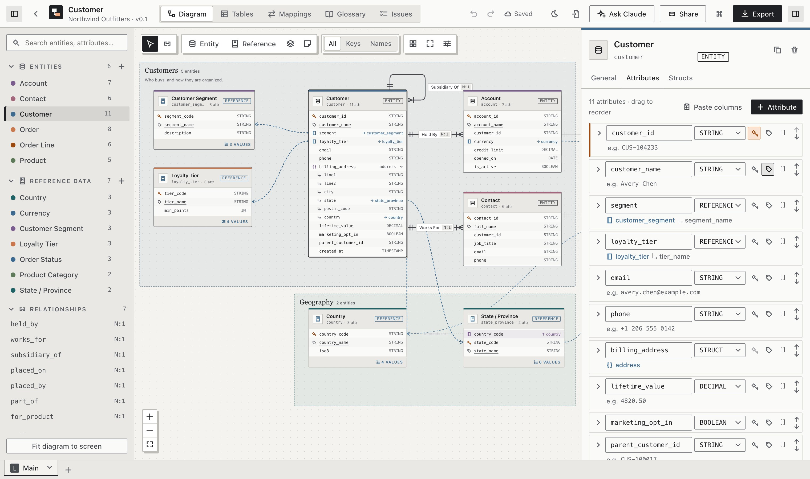
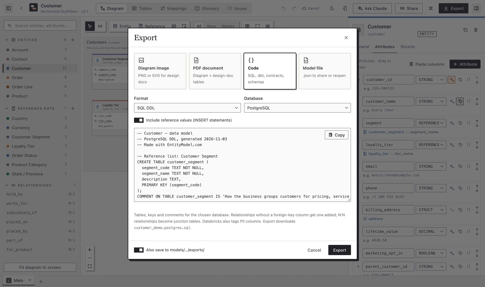
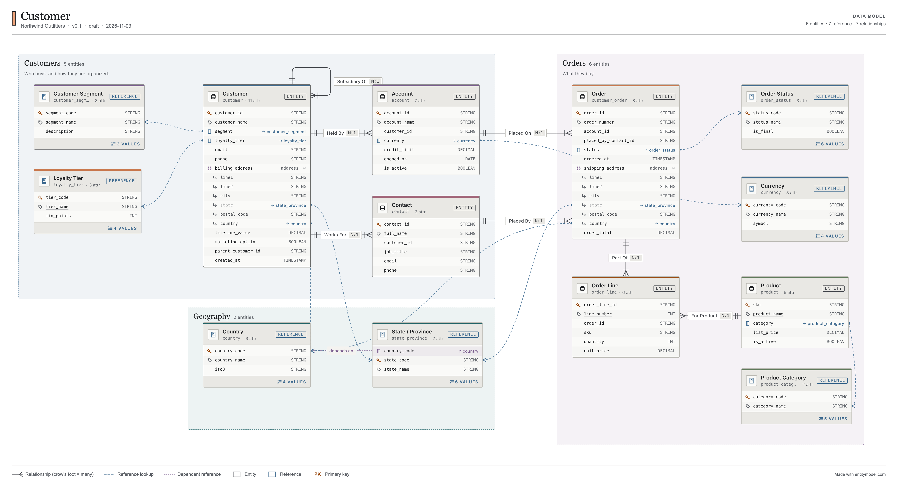

# EntityModel.com

**EntityModel.com** ([entitymodel.com](https://entitymodel.com)) is an open-source, browser-based tool for designing entity-relationship data models. You draw entities, attributes, reference lists, relationships and hierarchies on a canvas. It's free, needs no account, works offline once loaded, and installs as an app. The documentation is at [entitymodel.com/docs](https://entitymodel.com/docs/).



From the same model you can export:

- **Diagrams** as PNG (1×, 2× or 3×, with a title block and legend) or SVG.
- **PDF design documents** with a cover page, the diagram, and every documentation table.
- **Design-doc tables**: entity catalog, attribute dictionaries, reference data and values, relationships and hierarchies. Copy them as rich tables into Google Docs, Word or Confluence, or as Markdown or TSV.
- **Code**: SQL DDL (PostgreSQL, MySQL/MariaDB, Snowflake, Databricks), DBML for dbdiagram.io, or a Mermaid `erDiagram`. SQL and DBML import too.
- **The model file**, a single readable JSON document, to share, version or reopen. Or send a **share link** that carries the whole model.

Each model is one JSON file, `models/<id>/model.json`. The UI, the command-line tool and AI assistants such as Claude Code all edit that file, and the UI reloads live whenever it changes on disk.

## Two ways to use it

| | **In the browser** ([entitymodel.com](https://entitymodel.com)) | **Locally** (`npm run dev`) |
| --- | --- | --- |
| Where models live | In your browser (IndexedDB), on this device only | `models/<id>/model.json` files in the repo folder |
| Getting started | Open the site: no install, no account | Clone, `npm install`, `npm run dev` |
| Sharing and backup | **Share** link, or Export → Model file | The files themselves (git, a shared drive) |
| Offline | Works offline after the first visit; installable as an app | Always local |
| Claude and the CLI | Not available | Claude Code skills and `bin/em.mjs` edit the same files; the UI reloads live |

The app picks the mode by itself. When the local dev server's API answers, it uses files. Otherwise (the hosted site, or `npm run preview`), it uses browser storage. Add `?storage=browser` to the URL to force browser storage locally.

Browser storage is private to one browser profile. Clearing site data deletes it, so export the model file for anything you want to keep.

**Privacy:** your models never leave your browser unless you export or share them. entitymodel.com counts visits with [Cloudflare Web Analytics](https://www.cloudflare.com/web-analytics/), which uses no cookies and no personal data; self-hosted copies and local runs send nothing.

## Contents

1. [Quick start](#quick-start) (locally)
2. [Concepts](#concepts)
3. [UI tour](#ui-tour)
4. [Exports](#exports) · [Share links](#share-links) · [Offline and install](#offline-and-install)
5. [CLI](#cli)
6. [Designing with Claude](#designing-with-claude)
7. [Run it in the background (macOS, optional)](#run-it-in-the-background-macos-optional)
8. [Project layout](#project-layout)
9. [Deploy (Cloudflare)](#deploy-cloudflare)
10. [Contributing](#contributing)
11. [License](#license)

## Quick start

You need **Node.js 18 or later** (`node --version`).

```bash
git clone https://github.com/ns-3e/entitymodeler.git
cd entitymodeler
npm install
npm run dev          # opens http://localhost:5180
```

The home page lists the models in `models/`. A fresh clone contains one, **Customer**, a demo model for a fictional outdoor retailer (customers, accounts, contacts and orders), to explore; in browser mode, **Open the demo** copies it into your browser. Create a new model from the home page, or from the command line:

```bash
node bin/em.mjs new acme --title "Acme Orders" --org "Acme Corp"
```

## Concepts

| Concept | What it is |
| --- | --- |
| **Entity** | A business thing the model describes: Customer, Order, Product. It has typed attributes, one primary key and one display (label) attribute. |
| **Reference entity** | A controlled list of codes that other entities point at, such as country, currency or status. It can hold its full list of values. |
| **Dependent reference** | A reference list constrained by a parent list, such as Country → State → City. |
| **Struct** | A grouped or repeating set of fields on an entity, such as an address or a list of phone numbers. |
| **Relationship** | A named, typed link between two entities with a cardinality (1:1, 1:N, N:1, N:N) and forward and reverse labels. It can carry attributes of its own. |
| **Hierarchy** | Levels and branches built from relationships, such as company ownership or a product taxonomy. |
| **Areas and notes** | Subject-area rectangles and sticky notes on the canvas. |

The full file format is in [docs/model-format.md](docs/model-format.md).

## UI tour

- **Diagram**
  - Entities show their typed attributes, and relationships use crow's-foot notation.
  - Reference lookups draw from the attribute row to the reference entity; dependent references show as a "depends on" link.
  - The detail toggle switches between All, Keys and Names. Auto-layout, a minimap and hierarchy highlighting are also here.
- **Inspector**: select anything to edit it.
  - Entities have General, Attributes, Values (reference entities only) and Structs tabs.
  - Relationships, hierarchies (levels and branches), areas, notes and the model's own properties are edited here too.
- **Diagram tabs**: one model holds several diagrams, shown as tabs under the top bar. Each tab has its own entities, relationships and layout, and a kind: **Conceptual**, **Logical**, **Physical** or **Variant**.
  - **New tab → Derive** turns one tab into another, with a preview of what will change:
    - physical → logical: business names (`tbl_cust_mstr` → `customer`, `cust_nm` → `customer_name`), audit/ETL/SCD columns dropped, relationships instead of foreign-key columns, link tables as N:N, lookup tables as reference data, missing relationships inferred from key names;
    - logical → physical: foreign-key columns added, N:N resolved into junction tables, optional struct flattening and audit columns, a target platform;
    - → conceptual: entities and relationships only.
  - Derived tabs keep lineage (`derived_from`). **Compare** lists what was added, removed, renamed or changed between any two tabs, copies the diff as Markdown, writes **migration SQL** (ALTER/CREATE/DROP, renames as RENAME), and **syncs from source**. Sync re-derives the changes made in the source since the tab was made, and lists new entities, attributes, type changes and relationships to apply. Things the source dropped are listed but not selected. CLI: `em sync <id> <source> <target> [--apply|--propose]`.
  - **Copy** a tab for versions and what-if variants, or right-click a selection → **Copy to tab** / **New tab from selection**.
- **Selecting and hiding**
  - Drag on empty canvas to box-select; Shift- or ⌘-click to add and remove. Space+drag, middle-drag or two-finger scroll pans.
  - Right-click a selection for Hide, Show only these (optionally with neighbors), Select related, Arrange, Copy, Duplicate, Copy to tab, Color and Delete. Right-click empty canvas to add things where you clicked.
  - Hidden entities stay in the model, the tables and the docs. Toggle them from the sidebar's eye icons; **Shift+H** shows all.
- **Productivity**
  - **⌘K** command palette: jump to any entity, attribute (`order.status`), relationship or tab, or run any action.
  - Paste a `CREATE TABLE` statement, `name TYPE` lines or spreadsheet columns to bulk-add attributes.
  - Keyboard: `E` new entity, `R` relationship tool, `F` fit view, `H` hide, `⌫` delete the selection, `⌘C`/`⌘V` copy and paste (also across tabs), `⌘D` duplicate, `⌘A` select all, `⌘Z`/`⌘⇧Z` undo/redo, `⌘S` save.
- **Large models** (tested at 2,000 and 5,000 tables):
  - Past 60 entities only on-screen cards are drawn; zoomed out they show placeholder rows.
  - Past 300 entities and below 22% zoom the diagram switches to a single overview canvas: panning stays at 60 fps, and clicking an entity zooms into it.
  - Layouts of big models run in a background worker, long sidebar lists render only the rows in view, and bulk operations (derive, sync, fix all, diff, migration SQL) stay linear.
  - `npm run bench` times the core work at 500, 2,000 and 5,000 entities.
- **Reference values**
  - The Values tab holds a reference entity's full list. Paste it from Excel or CSV, import a file, or edit it inline.
  - The grid validates keys and parent codes.
  - Attributes that reference the list show its allowed values on hover.
- **Import from a database**: Import → **From a database** builds a metadata query for Databricks, Snowflake, PostgreSQL or MySQL. Run it in your own SQL tool and paste the result; the app never sees credentials.
  - Locally, `em pull` reads the schema directly instead (see CLI).
  - The first import of a schema becomes a Physical tab. Later imports become a dated version tab derived from the previous one, so **Compare** and migration SQL show what changed in the database.
- **Import SQL or DBML** (home page, or the import button in the top bar): paste or drop `CREATE TABLE` scripts or dbdiagram.io files.
  - Tables become entities and foreign keys become relationships.
  - Lookup tables (seeded with INSERTs, in a "Reference data" group, or named `*_type` / `*_status` / `ref_*`) become reference lists.
  - Junction tables become N:N relationships.
- **Design with Claude** (home page): copy a prompt for Claude and paste its result back as a new model. See [Designing with Claude](#designing-with-claude).
- **Tables**: every design-doc table, with Copy (rich), MD and TSV per table, plus Copy all and HTML or .md download.
- **Mappings** (top bar): source-to-target mappings into the active tab from any other tab.
  - **Auto-map** matches through derivation lineage, then by name (`CUST_NM` ↔ `customer_name`).
  - Each target attribute gets source columns, a transform and a draft/approved status, with coverage per entity.
  - Outputs: CSV, the generated **dbt model SQL**, and a "Source-to-target mappings" design-doc section.
  - Renames and deletes keep mappings in step.
- **Business glossary** (top bar): one glossary shared by every model (`models/_glossary.json` locally, this browser on the site). Each term has a definition, synonyms, a status, a domain and an owner.
  - Link entities and attributes to terms from the inspector. A matching name gets a one-click suggestion, or link every match in a tab at once.
  - Models embed the terms they use, so a model file stays self-contained.
  - Docs gain a glossary section, and blank descriptions borrow the term's definition. Databricks DDL tags columns with their business term.
- **Review comments**: threads on the model, an entity, an attribute or a relationship, with replies and resolve.
  - Open comments show on entity cards and in the sidebar, and follow renames.
  - Ask Claude can work through them: "Work through the open review comments" proposes fixes and replies to each.
- **Naming standards** (model inspector, per tab kind): attribute case, singular or plural entity names, prefixes, key suffix, abbreviation spelling, identifier length, required descriptions and PII review. Findings appear in Issues; renames (which cascade) and PII flags are fixed with **Fix**, **All N**, or **Fix automatically**. From the CLI: `em validate <id> --fix [--dry-run]`.
- **Issues**: live validation of names, keys, references, structs, relationships and hierarchies. Click an issue to jump to the exact place to fix it.

## Exports

Click **Export** in the top bar. Exports download to your computer. When running locally, they can also save a copy to `models/<id>/exports/`.

- **Diagram image**: PNG or SVG. The export uses the current view settings, so switch the detail level to **Keys** for an executive-level diagram.
- **PDF document**: pick sections and entities and choose Letter or A4. You get a cover with the model summary and linked contents, the diagram on a landscape page, then one chapter per section, with table headers repeated across pages.
- **Code**, with a preview and a Copy button:
  - **SQL DDL** for PostgreSQL, MySQL/MariaDB, Snowflake or Databricks. Databricks also tags PII columns.
  - **DBML** for dbdiagram.io, and a **Mermaid** `erDiagram` for READMEs and docs.
  - **dbt `schema.yml`** with data tests: not_null, unique keys, relationships for foreign keys, accepted_values from reference lists.
  - A **data contract** in the Open Data Contract Standard (ODCS v3).
  - **JSON Schema** (2020-12) and **Avro** record schemas.
  - SQL includes primary and foreign keys, comments, junction tables for N:N relationships and, optionally, INSERTs for reference values.
  - A relationship's key column comes from its **Foreign key** setting in the inspector.
- **Model file**: download `<name>.json` to share or back up. Open it again from the home page with **Open model file**, or by dropping it on the home page.





Every exported file credits EntityModel.com (entitymodel.com):
- a header comment in SQL, DBML and Mermaid;
- a small line under PNG and SVG diagrams;
- the PDF footer;
- the end of Markdown and HTML documents;
- a `source` field in the model file.

From the CLI, run `node bin/em.mjs docs <id> --format pdf`. It uses the newest diagram PNG in `exports/`, or the one you pass with `--diagram`.

## Share links

**Share** in the top bar copies a link like `https://entitymodel.com/#/share/v1.…` that contains the whole model, compressed. The demo model fits in about 3 KB.

- **Nothing is uploaded.** The model lives in the part of the link after `#`, and browsers never send that part to a server.
- **Opening a link offers "Open a copy".** The recipient gets their own copy to view and edit, and your model is not affected.
- **A link is a snapshot.** Later edits aren't included, so share again to send a newer version.
- **Very large models make long links,** which some chat apps cut off. For those, send the model file instead.

## Offline and install

The hosted site caches itself on first visit (a service worker built with each release), so it keeps working without a connection. Your models are already stored in the browser.
- **Install it as an app:** in Chrome or Edge, click **Install app** on the home page (or the install button in the address bar, or **Install EntityModel.com as an app** in the command palette, ⌘K). It then runs in its own window from your dock, Start menu or app launcher, and works offline. On iPhone or iPad, use **Share → Add to Home Screen**.
- **The installed app on your computer:**
  - It opens model `.json` files: right-click one and choose **Open with → EntityModel**, or drop it on the app's icon. Each file opens as a copy.
  - Right-clicking the app's icon offers **New model** and **Open the demo**.
- **Updates:** when a new release is deployed, the next visit picks it up and the app says so.

On phones, the side panels become drawers over the diagram. Tap an entity to see its details.

## CLI

`bin/em.mjs` is a zero-dependency bundle of the same core the UI uses.

```bash
node bin/em.mjs list
node bin/em.mjs new <id> --title "Title" --org "Organization"
node bin/em.mjs summary <id>
node bin/em.mjs validate <id> [--all]        # exits 2 on errors
node bin/em.mjs fmt <id>                     # normalize and re-save
node bin/em.mjs docs <id> [--format md|html|pdf] [--sections a,b] [--entities x,y] [--stdout]
node bin/em.mjs export <id> --format sql|dbml|mermaid|dbt|odcs|jsonschema|avro [--dialect postgres|mysql|snowflake|databricks] [--no-values] [--stdout]
node bin/em.mjs import <id> <file.sql|file.dbml> [--create]   # add tables to a model, or create one
node bin/em.mjs values <id> <reference-entity> <file.csv> [--append]
node bin/em.mjs values <id> <reference-entity> --export
node bin/em.mjs tabs <id>                                       # list diagram tabs
node bin/em.mjs derive <id> --kind logical|physical|conceptual [--from TAB] [--name N] [--dry-run]
node bin/em.mjs diff <id> <tabA> <tabB> [--format json]         # renames tracked through lineage
node bin/em.mjs migrate <id> <tabA> <tabB> [--dialect D]        # ALTER/CREATE/DROP DDL from A to B
```

Pull a live schema (credentials come from your environment or the platform's CLI profile and are never stored):

```bash
node bin/em.mjs pull <id> --from databricks --catalog main --schema sales [--profile P]   # Unity Catalog REST
node bin/em.mjs pull <id> --from snowflake --catalog ANALYTICS --schema SALES             # SQL API; SNOWFLAKE_ACCOUNT + SNOWFLAKE_TOKEN,
                                                                                         # or SNOWFLAKE_USER + SNOWFLAKE_PRIVATE_KEY_PATH
node bin/em.mjs pull <id> --from postgres --url postgres://… --schema public              # via psql
node bin/em.mjs pull <id> --csv result.csv --platform postgres                            # a query result you ran yourself
node bin/em.mjs catalog-query --platform snowflake --catalog DB --schema S                # print that query
```

`--tab <name|id>` picks the tab for `summary`, `docs`, `export`, `import` and `values` (default: the primary tab). `validate` checks every tab unless you pass `--tab`.

Run `node bin/em.mjs` with no arguments to see every option. After changing `src/core/` or `cli/`, rebuild the bundle with `npm run build:cli`.

## Designing with Claude

### Ask Claude in the app (local mode)

When you run EntityModel.com locally and the [Claude Code](https://claude.com/claude-code) CLI (`claude`) is installed, the top bar shows **Ask Claude** (⌘J). Describe a change, such as "add a Contract entity linked to Supplier" or "derive a physical model for Databricks", and Claude works on the model with the EntityModel.com tools.

- The run streams into the panel. It uses your current tab and canvas selection as context.
- Claude never edits files. It answers with a **proposal**: a list of typed changes that opens for review.
- In the review you see each change, can untick the ones you don't want, compare the before/after diff and the validation result, and then **Accept**. Accepting is one undoable step.
- Claude runs headless with only the EntityModel.com tools (no shell, no file editing), under your own Claude Code login.

### Agents and the MCP server

`node bin/em.mjs mcp` is an [MCP](https://modelcontextprotocol.io) server, and `.mcp.json` registers it for Claude Code in this repo. Agents get typed tools:
- read and check: `get_model`, `get_entity`, `search`, `validate`, `list_tabs`
- transform and generate: `diff_tabs`, `migration_sql`, `export`, `docs`, `derive_tab`, `import_ddl`
- change: `propose_changes`

Changes become proposals in `models/<id>/proposals/`. A banner in the UI offers them for review, and they can also be handled from the terminal:

```bash
node bin/em.mjs proposals <id>                     # list pending proposals
node bin/em.mjs proposals <id> --accept <pid>      # or --reject, --show
node bin/em.mjs apply <id> ops.json [--apply]      # the same typed operations without MCP
```

`npm run agent-eval` runs Claude on a realistic brief in `evals/` (a legacy ERP to logical, Databricks, mappings and dbt) and reports turns, cost, tool errors and the final validation. It's how changes to these tools are checked.

Start the server with `--allow-apply` to add `apply_changes`, which edits directly without review (for automation you trust).

### Copy and paste with claude.ai (any mode)

**Design with Claude** on the home page round-trips a model through [Claude](https://claude.ai). Nothing is sent anywhere by the app; you copy and paste. To have Claude change an existing model, export it (Export → Model file), attach it in Claude, and open the result with **Open model file**; or use Claude Code locally (below).

1. Optionally describe the change, then click **Copy prompt**. The prompt holds the instructions, the model file format and your current model.
2. Paste it into Claude (**Open Claude** opens claude.ai).
3. Paste Claude's whole reply back, or open the `.json` file it made. The dialog finds the JSON and lists what will change: entities added or removed, attributes changed, relationships, and the validation result.
4. Click **Apply changes**. Your layout is kept, new entities are placed automatically, and **⌘Z** undoes the whole change.

If you do this often, the dialog also offers a downloadable **EntityModel.com skill** (`entity-modeler-skill.zip`). Upload it once under **Customize → Skills** in Claude; after that you only attach your model file (Export → Model file) and ask for changes.

### With Claude Code (local mode)

The repo includes [Claude Code](https://claude.com/claude-code) skills in `.claude/skills/`:

| Skill | What it does |
| --- | --- |
| `entity-model-design` | Design or extend a model from requirements, DDL, CSV headers or spreadsheets |
| `entity-model-review` | Validate and critique a model before sharing it |
| `entity-design-doc` | Write the data-model section and tables of a design document |

To use them:

1. Open the folder in Claude Code; it reads `CLAUDE.md` and the skills directly.
2. Put source material in `models/<id>/inputs/`.
3. Ask, for example: "Design a Customer and Order model from the DDL in models/acme/inputs."

Claude edits `model.json` and runs `node bin/em.mjs validate` after each change. The change appears in the UI within a second, and **⌘Z** in the UI undoes it.

To use the skills in the Claude desktop app instead, run `npm run skills:package` and upload the zips from `cowork-skills/` under **Customize → Skills**.

## Reviewing model changes in pull requests

Keep `model.json` files in git and review changes the way you review code. `em review` compares each changed model with a base ref, tab by tab, and reports:
- what was added, removed, renamed or changed
- the validation result before and after
- migration SQL for physical tabs, with renames written as `RENAME`

```bash
node bin/em.mjs review                      # working tree vs. where this branch left origin/main
node bin/em.mjs review --base main --head my-branch --format md|json [--fail-on-errors]
```

`.github/workflows/model-review.yml` runs it on pull requests that touch `models/**/model.json` and posts the result as one comment, updated on every push. Copy the workflow (and `bin/em.mjs`) into any repository that keeps EntityModel.com models.

## Run it in the background (macOS, optional)

```bash
npm run service:install     # starts at login, restarts if it stops
npm run service:restart     # after pulling code changes
npm run service:logs
npm run service:uninstall
```

This installs a per-user launchd agent (`~/Library/LaunchAgents/com.entitymodeler.app.plist`) that listens on 127.0.0.1 only. To use another port, run `PORT=5181 npm run service:install`.

## Project layout

```
models/<id>/model.json   a model (only the demo is committed; see .gitignore)
models/<id>/inputs/      source material for that model
models/<id>/exports/     generated diagrams and docs (git-ignored)
src/core/                model types, validation, doc tables, PDF (no DOM or Node dependencies)
src/ui/                  the React app (React 18, React Flow 12, zustand + immer)
src/ui/storage/          where models are stored: files (dev-server API) or browser (IndexedDB)
src/server/api.ts        dev-server middleware that reads, writes and watches models/
src/server/pwa.ts        build plugin that generates the offline service worker (sw.js)
src/server/docs.ts       build plugin that renders site/docs/ into /docs/, sitemap.xml, llms.txt and llms-full.txt
site/docs/**/*.md        the documentation site's pages (front matter: title, seo_title, description, section, order, model)
site/examples/*.json     the example models shown at /docs/examples/
site/og/*.jpg            link-preview images for the docs pages (npm run og-images)
public/_headers          Cloudflare caching and security headers
public/manifest.webmanifest, public/icons/, public/og-image.png   install manifest, app icons, link-preview image
wrangler.jsonc           the Cloudflare Worker that serves dist/ (static assets only)
cli/em.ts → bin/em.mjs   the CLI
docs/model-format.md     the model file format
```

## Deploy (Cloudflare)

The hosted site is the static build (`npm run build` → `dist/`), served by a Cloudflare Worker with static assets (the Worker is named `entitymodeler`); it needs no server code.

1. In the Cloudflare dashboard, go to **Workers & Pages → Create → Import a repository** and pick this repository.
2. Build settings: build command `npm run build`, deploy command `npx wrangler deploy`. `wrangler.jsonc` defines the Worker: it serves `dist/` as static assets, with no Worker code. Node 20 comes from `.nvmrc`.
3. Under the Worker's **Settings → Domains & Routes**, add the custom domains `entitymodel.com` and `www.entitymodel.com`.

Every push to `main` builds and deploys to production. Every other branch builds with `npx wrangler versions upload`, which gives each pull request its own preview URL without touching production. In the dashboard this is the Worker's **Settings → Builds → Non-production branch builds** setting. A zone Redirect Rule sends `www.entitymodel.com` to `entitymodel.com`.

`public/_headers` sets long-lived caching for hashed assets and a strict Content-Security-Policy. Routing is hash-based (`#/model/<id>`), so no redirect rules are needed inside the app.

To deploy from your machine instead: `npm run build && npx wrangler deploy`.

To try the production build locally: `npm run build && npm run preview` (http://localhost:5181, browser mode).

## Contributing

Issues and pull requests are welcome. Changes go in through pull requests; the **CI** check (`.github/workflows/ci.yml`) runs on each one and should pass before merging. Each PR also gets a Cloudflare preview URL to try the change in the browser. To run the same checks locally:

```bash
npm run typecheck
npm test                       # vitest: import/export round-trips; generated Postgres DDL runs in PGlite
npm run build
npm run build:cli && node bin/em.mjs validate customer-demo   # commit bin/em.mjs if it changed
```

Check UI changes in both storage modes: `npm run dev` (files) and `npm run build && npm run preview` (browser).

The README screenshots in `docs/images/` and the documentation-site screenshots in `site/docs/images/` (light, and `-dark` for readers in dark mode) are taken from the demo model by `npm run screenshots` (headless Chrome against `npm run dev`). Rerun it after visible UI changes. `npm run ui-audit` opens every dialog, view, panel and inspector tab at two window sizes and reports anything that sticks out of its container or a text box drawn shorter than its rows.

Good first contributions: offline install (PWA), shareable links, more SQL dialects (SQL Server, BigQuery, Oracle), and Mermaid import.

Keep `src/core` free of DOM and Node APIs so it runs in both the browser and the CLI. Node geometry in `src/ui/canvas/geometry.ts` must match the `.entity-node` CSS.

## License

[MIT](LICENSE). The bundled fonts (Schibsted Grotesk, DM Serif Display and IBM Plex Mono, in `src/core/assets/` for the PDF and from `@fontsource` in the app) are under the SIL Open Font License; see the `OFL-*.txt` files in `src/core/assets/`.
