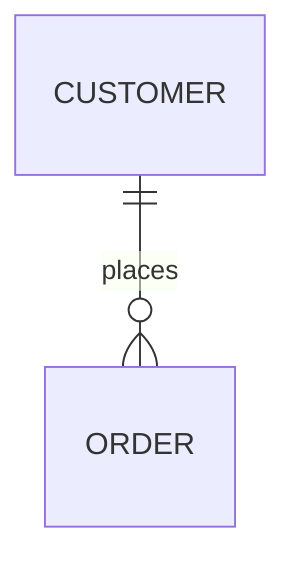

Every model can be exported as code. Click **Export → Code**, pick a format, and you get a live preview with a Copy button and a download.


## SQL DDL

Choose the dialect: **PostgreSQL**, **MySQL/MariaDB**, **Snowflake** or **Databricks** (Delta tables). The script includes:

- `CREATE TABLE` for every entity, with mapped data types for the dialect;
- primary keys, `NOT NULL` for required attributes and `UNIQUE` constraints;
- foreign keys for relationships and reference lookups;
- junction tables for many-to-many relationships;
- table and column comments from the descriptions (`COMMENT ON` in PostgreSQL, inline `COMMENT` elsewhere);
- optionally, `INSERT` statements for reference list values;
- for Databricks, tags on PII columns and on columns linked to a business glossary term.

### Foreign key columns

A relationship's key column comes from its **Foreign key** setting in the inspector. When it's not set, the export looks for a column named after the parent's key (`customer_id`) and, failing that, adds one. Set it explicitly for unusual names such as `parent_supplier_id`.

### Logical or physical?

You can export any tab. For a logical model, the export resolves the logical design into tables (foreign key columns and junction tables). For full control over physical names, flattened structs, audit columns and platform details, derive a **physical** tab first and export that. See [Derive, compare and migrate tabs](/docs/derive-compare-migrate/).

For changes to an existing database, generate **migration SQL** between two tabs instead of a full script.

## DBML

DBML is the format used by [dbdiagram.io](https://dbdiagram.io) and other DBML tools. Reference entities are grouped as "Reference data"; their values are not part of DBML. EntityModel.com also imports DBML, so you can move a dbdiagram.io diagram in and out.

## Mermaid erDiagram

A Mermaid `erDiagram` renders as a diagram on GitHub, GitLab, Notion and [mermaid.live](https://mermaid.live). Paste it into a fenced block in a README or wiki page:

````markdown

````

Platform guides: [Snowflake](/docs/platforms/snowflake/), [Databricks](/docs/platforms/databricks/), [PostgreSQL](/docs/platforms/postgresql/).

## Other formats

- **dbt `schema.yml`**, an **ODCS data contract**, **JSON Schema** and **Avro**: see [dbt and data contracts](/docs/dbt-and-data-contracts/).
- **Diagrams and PDF documents**: see [Diagrams and design documents](/docs/design-documents/).

## From the command line

```bash
node bin/em.mjs export sales --format sql --dialect snowflake --stdout
node bin/em.mjs export sales --format sql --dialect postgres --no-values   # without reference INSERTs
node bin/em.mjs export sales --format dbml
node bin/em.mjs export sales --format mermaid --tab Conceptual
```

Every exported file carries a header comment crediting EntityModel.com.

## Frequently asked questions

### Can I generate PostgreSQL CREATE TABLE statements from an ER diagram for free?

Yes. In EntityModel.com, open Export → Code, choose SQL DDL and PostgreSQL. The script includes tables, primary and foreign keys, constraints, comments and junction tables, and you can copy or download it.

### Does it support Snowflake and Databricks?

Yes. SQL export has Snowflake and Databricks (Delta) dialects alongside PostgreSQL and MySQL/MariaDB. Physical tabs can target one platform each.

### Can I convert DBML to SQL?

Yes. Import the DBML file, then export SQL DDL in the dialect you need.
